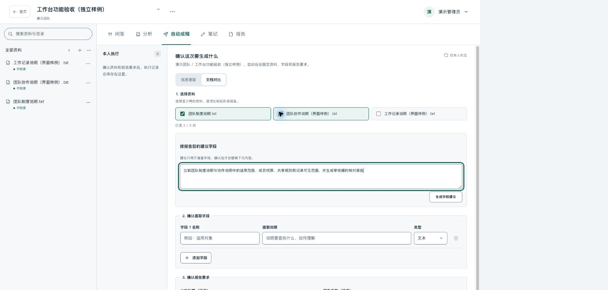

# 智能文档与知识工作台

把分散的资料整理为可查阅、可提问、可分析的知识库，从原文中核对答案，再将有用内容保存为笔记或报告。

适合资料问答、制度查询、知识学习，以及多份文档的信息整理与比较。

## 可以做什么

| 功能 | 用法 |
| --- | --- |
| 资料管理 | 上传文件、粘贴文字或导入公开网页，用多级文件夹整理资料 |
| 文档问答 | 针对整个知识库或指定资料提问、连续追问，点击引用查看原文位置和摘录 |
| 信息提取与对比 | 指定要提取的字段或比较维度，逐份查看结果、差异、缺失项与依据 |
| 知识笔记 | 保存有用的回答、摘录与自己的理解，随时编辑和查找 |
| 报告 | 从资料、笔记或分析结果生成报告，核对依据、编辑章节并导出 |
| 自动成稿 | 确认资料和要求后，后台连续完成分析与报告草稿，支持查看进度、取消和失败后继续 |

## 开始使用

1. **登录并加入团队。** 向管理员获取访问地址与账号，或通过邀请链接设置账号并加入团队。已有账号可登录后接受邀请。
2. **进入或新建知识库。** 首页显示你有权访问的知识库。新建时选择所属团队，并决定团队可见或私人可见。
3. **添加资料。** 在“全部资料”或文件夹的菜单中上传文件、粘贴文字或导入网页，等待处理完成。
4. **选择工作方式。** 在知识库内切换“问答”“分析”“自动成稿”“笔记”或“报告”。提问可先指定资料；分析可描述目的，让系统建议字段后再确认。
5. **核对并保存成果。** 点击引用查看原文。将回答保存为笔记，或编辑报告后保存、导出。

分析和自动成稿提交后，即使关闭页面也会继续处理；再次进入可从本人记录查看进度与成果。自动生成的报告是待核对草稿，可以继续修改。

## 支持的资料与导出格式

- **文件：** 可提取文字的 PDF、Word（DOC/DOCX）、TXT、Markdown、HTML/HTM。
- **其他来源：** 粘贴文字、公开网页单页正文。网页导入不包含整个站点。
- **报告导出：** Word（DOCX）、PDF、Excel（XLSX）、CSV。

默认单文件不超过 20 MB，实际额度以管理员配置和页面提示为准。扫描件 OCR、图片及复杂图表理解暂不支持；普通 Word 表格可以读取，复杂合并、嵌套或排版可能影响结果。

## 团队与可见范围

团队之间的资料相互隔离。知识库有两种可见范围：

- **团队可见：** 团队成员按知识库权限使用，适合公共资料。
- **私人可见：** 仅创建者和明确获授权的成员可以访问，团队管理员不会自动获得访问权。

知识库显示你的实际权限：“只读”可查阅并使用问答、分析等功能；“可编辑”还可添加资料；“可管理”可维护资料、目录、知识库设置与成员授权。没有添加资料入口时，联系知识库管理者确认权限。

问答记录、分析、自动成稿、笔记和报告仅创建者本人可见，不会因知识库团队可见而自动共享。团队管理员负责团队信息、成员和邀请；个人菜单中可修改名称、密码或退出团队。

## 核对与更新资料

回答和分析结果中的引用可以打开原文依据。资料不足、未提及、待核实和处理失败会分别显示；使用结论前，应核对其原文与适用条件。

资料换版后，相关报告会提示来源需要复核。核对后勾选确认并保存，才会清除提示；已有人工修改不会自动被覆盖。删除资料后，旧问答仍保留答案，但不再展示已删除来源的摘录；相关分析会失效。

## 常见问题

- **资料或分析一直排队：** 稍后刷新查看；持续无进展时联系管理员检查处理服务。
- **结果显示缺失或待核实：** 打开依据确认原文，补充资料或调整字段说明后重新分析。
- **看不到原来的知识库：** 检查当前账号与团队，联系管理者确认访问权限。
- **登录后要求修改密码：** 管理员重置密码后需先设置新密码，再重新登录。

安装、配置、启动与维护见 [运行手册](docs/operations/LOCAL-DEVELOPMENT.md)。
